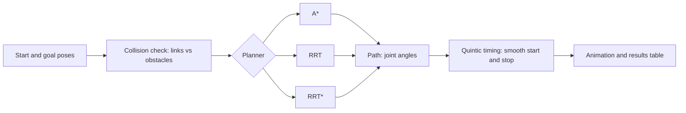

# Robotic Arm Path Planning: A*, RRT and RRT*

Path planning for a robotic arm, written in Python. A planar arm moves from a start pose to a goal pose without any **link** touching an obstacle. We compare three classic planners (**A\***, **RRT**, **RRT\***) and animate the result.

> **Scope:** this is a software and simulation project. There is no physical robot. The arm is a model that the planner works on.


*Left to right: A\*, RRT, RRT\*. Green = start pose, blue = goal pose, red = obstacle, gold line = path of the hand.*

---

## What the project does

- Models a planar arm with 2 joints (3 or more also work) and checks that **every link** stays clear of obstacles.
- Plans in **joint-angle space**, where the whole arm is one point and obstacles become forbidden regions.
- Compares **A\*** (grid search), **RRT** (random tree) and **RRT\*** (random tree that keeps improving).
- Animates each path with smooth start and stop using a **quintic (5th-degree) polynomial** time curve.
- Prints a results table: time, waypoints, joint motion, hand path length and **minimum clearance** (our number for "safest").

## How it works



| Idea | In one line |
|---|---|
| **Configuration space** | Plan in joint angles. The whole arm is one dot; an obstacle becomes a forbidden blob. |
| **Collision check** | Each link is a line segment, each obstacle a circle or sphere. A pose is invalid if the distance is less than the radius plus a safety margin. |
| **A\*** | Searches a grid, always expanding the cell with the smallest `f = g + h`. Optimal on the grid, but the grid explodes with more joints. |
| **RRT** | Grows a tree: sample, find nearest node, step toward it, check collision. Fast in many dimensions, but the path is jagged. |
| **RRT\*** | RRT plus *best parent* and *rewire*, so the path gets shorter and straighter over time. |
| **Path vs trajectory** | A path is the route. A trajectory is the route plus timing. |


*Joint space for a 2-joint arm. Every point is one full arm pose. Pink poses would hit the obstacle.*

## Results

One run on the default scene (`SEED = 1`). RRT and RRT\* are random, so numbers change slightly between runs.

**Moving 2-joint arm** (`arm_planning.py`)

| Planner | Time (s) | Waypoints | Joint motion (deg) | Min clearance |
|---|---|---|---|---|
| A\* | 0.34 | 90 | 314 | 0.052 |
| RRT | 0.04 | 65 | 382 | 0.050 |
| RRT\* | 0.27 | 19 | 319 | 0.055 |

**2D point robot** (`path_planning.py`, straight-line minimum = 127.3)

| Planner | Path length | Time (s) |
|---|---|---|
| A\* | 139.0 | 0.08 |
| RRT | 167.7 | 0.01 |
| RRT\* | 131.4 | 0.43 |


**The curse of dimensionality, live:** set `LINKS = np.array([1.0, 0.8, 0.6])` in `arm_planning.py`. With 3 joints A\* gives up after 3,000 grid cells, while RRT and RRT\* still find a path. With 100 values per joint, a 7-joint arm would need 10^14 grid cells.

## Quick start

Requires Python 3.9 or newer.

```bash
git clone https://github.com/<your-username>/robotic-arm-path-planning.git
cd robotic-arm-path-planning
pip3 install -r requirements.txt

python3 arm_planning.py      # moving arm + animation (saves arm_motion.gif, arm_paths.png, cspace.png)
python3 path_planning.py     # 2D comparison (saves comparison.png)
```

Run the commands from the project folder. Output files are saved in the folder you run from.

## Settings you can change

At the top of `arm_planning.py`:

| Setting | What it does |
|---|---|
| `LINKS` | Link lengths. `[1.0, 1.0]` is 2 joints, `[1.0, 0.8, 0.6]` is 3. |
| `START_Q`, `GOAL_Q` | Start and goal joint angles in degrees. |
| `OBSTACLES` | List of `[x, y, radius]`. |
| `MARGIN` | Safety margin kept between links and obstacles. |
| `SEED` | Change it to get a different random run of RRT and RRT\*. |
| `SHORTCUT` | `True` deletes unneeded waypoints from RRT and RRT\* paths. |
| `SAVE_GIF` | `False` skips saving the GIF (faster). |

## Project structure

```
robotic-arm-path-planning/
├── arm_planning.py      # moving arm: A*, RRT, RRT*, collision checks, animation
├── path_planning.py     # 2D point-robot comparison of A*, RRT, RRT*
├── requirements.txt
├── images/              # GIF and figures used in this README
└── docs/                # study notes
```

## Limitations and future work

- Static obstacles only; simulation only.
- Planar arm. The same planners extend to a 7-joint arm in 3D by changing the forward kinematics and the collision check.
- Joint torques and velocity limits are not modelled; timing uses a simple quintic curve.
- Planned: run each planner many times and report averages, add RRT-Connect and Informed RRT\*, compare with the Whale Optimization approach from the reference paper.

## References

- Hart, Nilsson, Raphael (1968). A formal basis for the heuristic determination of minimum cost paths. *IEEE Trans. Systems Science and Cybernetics.*
- LaValle (1998). Rapidly-exploring random trees: a new tool for path planning. *Technical report, Iowa State University.*
- Karaman, Frazzoli (2011). Sampling-based algorithms for optimal motion planning. *Int. J. Robotics Research.*
- Elgohr, Kasem, Elhadidy (2026). Comparative analysis of robotic arms path planning techniques: case study of the KUKA KR4 R600 using the Whale optimization algorithm. *Int. J. Intell. Robot. Appl.* 10:209-226.

*Please check publication details against the originals before citing.*

